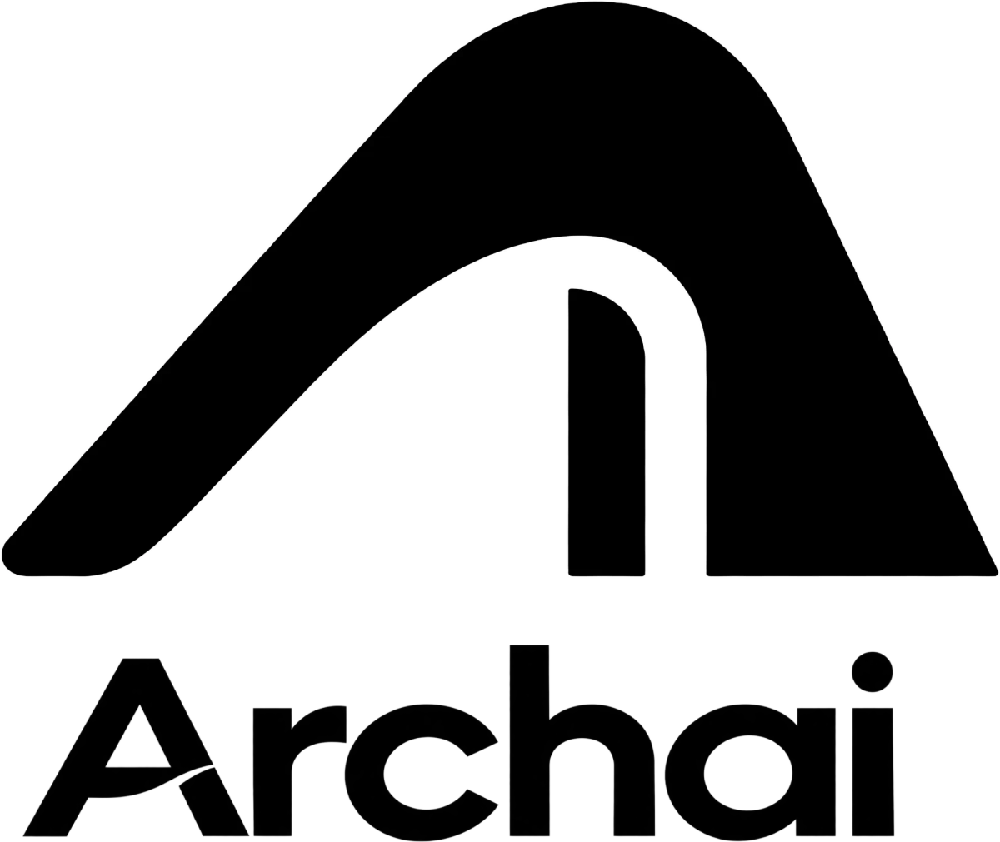

<p align="center">
  
</p>

<h1 align="center">ArchAI</h1>

<p align="center">
  A source-available architectural workspace: plans, 3D, sheets, rendering and VR walkthroughs in one
  command-driven board, live-linked with Revit, AutoCAD, Rhino, SketchUp, Blender, 3ds Max and Unreal.
</p>

<p align="center">
  <a href="https://archai-studio-six.vercel.app">Open in the browser</a> ·
  <a href="https://pub-56da091dd4ec4d00a47cd0aaa54fcef1.r2.dev/ArchAI-Setup-0.2.2.15.exe">Windows</a> ·
  <a href="https://pub-56da091dd4ec4d00a47cd0aaa54fcef1.r2.dev/ArchAI-0.2.2.15.apk">Android / Meta Quest</a> ·
  <a href="../../releases">All releases</a> ·
  <a href="docs">Documentation</a> ·
  <a href="CONTRIBUTING.md">Contributing</a>
</p>

---

## What it is

ArchAI is a board for architectural design. Everything you can do (draw a wall, place a door,
cut a section, publish a VR tour) is a **command** with a typed input, and the project is a plain
serialisable **document**. The same commands drive the toolbar, the command palette
(<kbd>Ctrl</kbd>+<kbd>K</kbd>), keyboard shortcuts, the modelling-app plugins and AI agents, which
keeps the app small, testable and easy to automate.

| | |
|---|---|
| **2D board** | Walls, doors, windows, stairs, rooms, columns, railings, annotations, dimensions, diagrams, hatches and line types, levels and a board elevation. |
| **3D** | A live 3D view of the same model with presets, sections, display styles and materials ([docs](docs/3d-view-and-presets.md)). |
| **Modeling** | A separate workspace for free-form assets: sketches, work planes, extrusions and a solid kernel, packaged as `.CAI` files ([docs](docs/modeling.md)). |
| **Parametric design** | Node graphs that drive geometry and parameters ([docs](docs/parametric-design.md)). |
| **Site analysis** | Maps, site boundaries, massing, sun and wind studies ([analysis](src/analysis)). |
| **Sheets and export** | Sheets with views, title blocks and scale bars; PDF, image, DXF/CAD and glTF export ([docs](docs/sheets-and-export.md)). |
| **ArchAI Render** | Real-time and path-traced rendering with sun, skies, PBR materials and entourage ([docs](docs/render-studio.md)). |
| **VR tours** | Place stops and publish a short link that opens in a Meta Quest or any browser ([docs](docs/vr-tours.md)). |
| **Plugins** | Revit, AutoCAD, Rhino, SketchUp, Blender, 3ds Max and Unreal: send models, open `.AIR` files, keep a live link, open in VR ([docs](docs/plugins.md)). |
| **Together** | Online projects edited by several people at once, with live cursors, invite links and roles ([docs](docs/accounts-and-cloud.md)). |

It runs in the browser (https://archai-studio-six.vercel.app), as a Windows desktop app (Electron)
and on Android tablets and Meta Quest (a native host around the same web app). Where everything is
hosted is in [docs/hosting.md](docs/hosting.md).

## Accounts and the ArchAI cloud

ArchAI works **without an account**: local projects, files, export, plugins and the live link
need nothing online.

An ArchAI account adds the cloud services run by the project: online projects and editing
together, the asset, material and render libraries, and VR links. **Accounts are by invitation
for now**: email **[mklkoklpp@gmail.com](mailto:mklkoklpp@gmail.com?subject=ArchAI%20account%20request)**
and you will get an email and password to sign in with.

The server code is in this repository ([`workers/`](workers)), so you can also run the whole
cloud locally for development (see below). The hosted services, their data and their secrets are
not part of this repository.

The **VR viewer** that VR links open (https://archai-vr.vercel.app) is a separate app kept in a
**private** repository; it is not part of this repository. ArchAI publishes tours in a documented
format ([docs/vr-tours.md](docs/vr-tours.md)), and the VR share Worker decides which viewer opens
them.

## Getting started (development)

Requirements: **Node.js 22.12+** and npm. Windows, macOS or Linux for the web app; Windows for the
desktop installer; Android SDK/JDK 17 for the Android app.

```bash
git clone https://github.com/Hussein5645/archai-studio.git
cd archai-studio
npm install
npm run dev          # web app at http://localhost:5173
```

| Command | What it does |
|---|---|
| `npm run dev` | Web app with hot reload |
| `npm run desktop` | Desktop app (Electron) against the dev server |
| `npm test` | Unit tests (Vitest) |
| `npm run test:e2e` | End-to-end tests (Playwright) |
| `npm run typecheck` | TypeScript for the app, tools and Electron |
| `npm run lint` | ESLint |
| `npm run build` | Typecheck, web build and Electron build |
| `npm run dist:win` | Windows installer in `release/` |

Android: `cd native && ./gradlew :androidApp:assembleDebug` (builds the web app first; add
`-PskipWebBuild` to reuse `dist/`). Plugins: `plugins/build-plugins.ps1` and `revit/build-packages.ps1`
(see [docs/plugins.md](docs/plugins.md)).

### Running the cloud locally

Everything online (accounts, online projects, live boards, libraries, VR sharing) is a set of
Cloudflare Workers you can run on your machine with [wrangler](https://developers.cloudflare.com/workers/wrangler/):

```bash
cd workers/archai-cloud
printf 'LIBRARY_SECRET=dev-only\nALLOW_SIGNUP=1\n' > .dev.vars
npx wrangler d1 execute archai --local --file schema.sql
npx wrangler dev --local --port 8787
```

Then start the app against it (development builds can create accounts on a local worker):

```bash
VITE_CLOUD_URL=/__cloud ARCHAI_LOCAL_CLOUD=http://127.0.0.1:8787 npx vite --port 5175
```

See [docs/accounts-and-cloud.md](docs/accounts-and-cloud.md) for how it works.

## Project layout

```
src/
  commands/     every action as a typed command, the executor, undo/redo
  document/     the project document: schema, ids, queries, invariants
  render/       the 2D board (SVG) and overlays
  view3d/       the 3D view, VR export
  modeling/     the asset modeling workspace
  studio/       ArchAI Render
  cloud/        accounts, online projects, editing together
  ui/           panels, dialogs, toolbar
  platform/     the one boundary to the host (web, Electron, Android)
electron/       desktop host (windows, files, live link server)
native/         Android / Meta Quest host (Kotlin)
plugins/        modelling-app plugins (AutoCAD, Rhino, SketchUp, Blender, 3ds Max, Unreal)
revit/          Revit add-in and setup
workers/        Cloudflare Workers: archai-cloud (accounts, projects, boards), vr-share
docs/           design notes and feature documentation
e2e/            Playwright tests
```

The document is the single source of truth and changes only through commands
([src/commands](src/commands)); hosts implement the `Platform` interface
([src/platform/types.ts](src/platform/types.ts)) and nothing else in `src/` talks to Electron or
Android.

## Contributing

Issues and pull requests are welcome. Read [CONTRIBUTING.md](CONTRIBUTING.md) first; for security
problems see [SECURITY.md](SECURITY.md).

## License

ArchAI is **source-available**, not open source. It is licensed under the
**PolyForm Strict License 1.0.0** with an additional permission for contributors
([LICENSE](LICENSE)):

- You may use ArchAI for **non-commercial** purposes: personal use, study, research, hobby
  projects, and use by schools, universities, charities and public institutions.
- You may **fork this repository and change the code only to send pull requests back here**, and
  run your changed version privately to test them.
- You may **not** redistribute ArchAI or changed versions, publish your own builds, use it in
  other projects, or use it commercially without permission. For any of that, email
  [mklkoklpp@gmail.com](mailto:mklkoklpp@gmail.com).

Contributions are welcome under the contributor agreement in [CONTRIBUTING.md](CONTRIBUTING.md).
Versions published before 2026-10-10 (up to release v0.2.2.13) were released under the GNU AGPL
v3.0 and remain available under it.

Product names and logos of other applications (Autodesk Revit, AutoCAD and 3ds Max, Rhino,
SketchUp, Blender, Unreal Engine, Twinmotion) belong to their owners. They appear only to show
which applications ArchAI works with and are not covered by this license; see [NOTICE.md](NOTICE.md).
